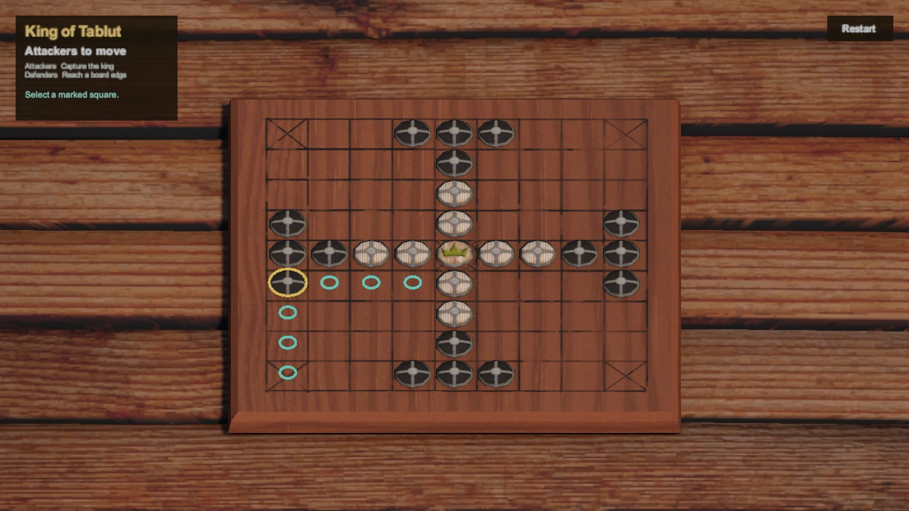

# King of Tablut

King of Tablut is a strategy game built in Unity for two local players or one player against the computer. The attackers try to capture the king. The defenders try to get the king to any edge of the board.

[Play WebGL Demo](https://nikorasuchan.itch.io/king-of-tablut-demo) · [Download for Windows](https://github.com/Nichii/King-of-Tablut-Showcase/releases/latest/download/King-of-Tablut-Windows.zip) · [Watch gameplay](https://github.com/Nichii/King-of-Tablut-Showcase/releases/latest/download/King-of-Tablut-Gameplay.mp4) · [Read the rules code](Assets/Junnav/King%20Of%20Tablut/Code/Scripts/Rules/TablutGameMode.cs)



## Engineering highlights

- **Shared rules.** `TablutGameMode` owns the board, turns, and win conditions. The Unity controller reads the match state to render pieces and uses each move result for feedback. The rules assembly has no UnityEngine references. The .NET tests compile the same rules source and NUnit fixtures. [Rules assembly](Assets/Junnav/King%20Of%20Tablut/Code/Scripts/Rules/Junnav.KingOfTablut.Rules.asmdef) · [Unity controller](Assets/Junnav/King%20Of%20Tablut/Code/Scripts/Gameplay/TablutMatchController.cs)
- **Tactical scenarios.** Scenarios are editable in the Inspector. Validation checks the layout and confirms the starting side has a legal move. Restart creates a fresh match from the asset. [Scenario validation](Assets/Junnav/King%20Of%20Tablut/Code/Scripts/Gameplay/TablutScenario.cs)
- **Measured move generation.** Walking four directions stops the search at pieces, the throne, and board edges. It ran 2.3–5.3× faster across three standalone .NET benchmark positions, with the same destination sets and allocations. [Legal move benchmark](Docs/MoveBenchmark.md) · [Windows and Web profiling](Docs/PlayerProfiling.md)

### Throne movement regression

One regression came from the throne at `(4,4)`. Moving from `(2,1)` to `(6,1)` was rejected because the path crossed column 4. The [fix checks the full square](https://github.com/Nichii/King-of-Tablut-Showcase/commit/592ccfe) and tests valid moves across both axes, alongside the test that blocks a move through the throne itself.

## Play

Extract the released Windows ZIP and run `King of Tablut.exe`, or open the WebGL demo above.

For the latest menus, open `TablutGameplayScene` in Unity **6000.3.24f1** and enter Play Mode, or build from this checkout. Choose **Play Local** to share the board or **Play vs Computer** to play as the attackers. Open **How to Play** and use **Next** to learn setup, movement, pawn capture, king capture, and how the match ends. The final page explains tabletop variations.

Click one of your pieces to see its legal destinations, then click a marked square. Open **Menu** during the match to resume, restart, open **How to Play**, or return to the main menu. The result screen shows who won and why. Choose **Play Again** to start a fresh match in the same mode.

See the [Tablut rules](Docs/Rules.md) for movement, captures, and how a match ends.

### Try the King Escape scenario

Open `TablutGameplayScene`, select **Tablut Match**, and assign **King Escape** from `Level/Scenarios` to the controller's **Scenario** field. Enter Play Mode, choose **Play Local**, and slide the king to the edge. **Restart Match** or **Play Again** reloads the assigned layout. Clear the field to play the standard match.

To make a scenario, use **Assets → Create → Tablut → Scenario**. Enter the starting side and piece coordinates from 0 to 8. The asset's **Validate Scenario** menu command reports problems in the Console. If an assigned scenario is invalid, the scene logs the reason and starts a standard match.

### Play against the computer

Choose **Play vs Computer** at the main menu. The computer picks a legal defender move. To reproduce a match, set **Opponent Seed** on **Tablut Match** in the Inspector. Restarting resets the seed, and repeating the same moves yields the same replies within the same runtime.

If the computer has no legal move, the match stays on its turn. **Restart Match** is available in the match menu.

## Build from source

Open the project in Unity **6000.3.24f1**. Install **Web Build Support** for that editor version through Unity Hub if you want a browser build.

Open **File -> Build Profiles**, make the target platform active, and confirm that `TablutGameplayScene` is enabled in the Scene List.

- **Windows.** Select **Windows** and **Intel 64-bit**, then choose **Build** and save to `Builds/Windows`. Run the generated executable with the rest of the build files in the same folder.
- **Web.** Select **Web**, then choose **Build and Run** and save to `Builds/Web`. Unity serves the build locally and opens it in your browser. The first Web build can take several minutes.

To check either build, choose **Play Local**, make an opening move, then choose **Menu** → **Restart Match**. The opening position should return with the attackers to move.

## Tests

In Unity, open **Window → General → Test Runner**. In **EditMode**, choose **Run All** for the board, turn, and match rules. In **PlayMode**, choose **Run All** for the gameplay scene tests, which check the tutorial, match menus, board clicks, move feedback, and both win screens. [Rules tests](Assets/Junnav/King%20Of%20Tablut/Code/Tests/Edit%20Mode%20Tests/Gameplay/TestTablutGameMode.cs) · [Scene tests](Assets/Junnav/King%20Of%20Tablut/Code/Tests/Play%20Mode%20Tests/Gameplay/TestTablutGameplayScene.cs)

### Run the rules tests without Unity

From the repository root, use the .NET 10 SDK to run the board, turn and match tests. The .NET projects compile the same C# rules and NUnit fixtures as Unity.

```sh
dotnet test DotNet/Rules.Tests/Junnav.KingOfTablut.Rules.Tests.csproj
```

## Project scope

This repository is a playable slice of an independent project. The full commercial project remains under private development. Source and assets here are provided for portfolio review and technical evaluation. All rights reserved, subject to applicable third-party licences.
